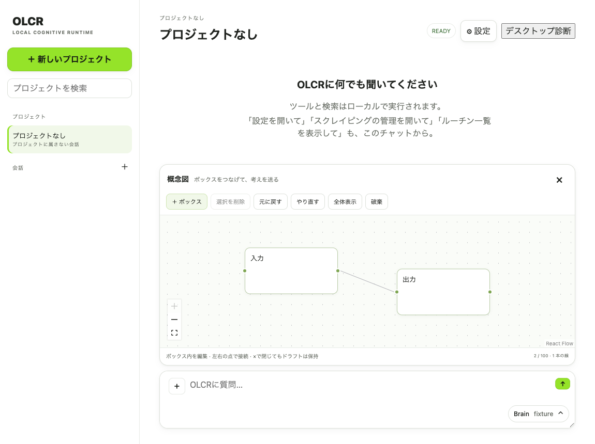

# チャット内概念図機能 計画書

作成日: 2026-10-06  
状態: 初期版のソース実装完了（2026-10-06）。ネイティブ配布アプリでの起動確認は未実施。

## 1. 目的

チャットの `＋` メニューから概念図エディターを開き、チャット入力欄の上に表示する。ユーザーは文字入りのボックスを作成し、線で接続・編集した後、通常のメッセージと一緒に送信できる。

図は画像だけでなく、ノードと接続関係を保持した構造データとしてOLCRに渡す。これにより、会話上の説明、要件整理、実装計画、後続の推論で図の各要素を参照できるようにする。

## 2. 現状と再利用方針

- `frontend/src/ChatComposer.tsx` に入力欄、`＋` のファイル添付ボタン、添付ファイルのプレビューと削除操作がある。
- `frontend/src/main.tsx` がチャット送信を組み立て、現在はテキストと単一ファイル添付を `/chat` に送っている。
- `backend/olcr_api/db.py` の `messages.blocks_json` が構造化メッセージブロックを保存し、会話の再読込でも返す。
- チャット表示は `main.tsx` 内でブロック種別ごとに描画している。
- フロントエンドは React + TypeScript + Vite。現行 `package.json` に図エディターは含まれていない。
- 描画UIにはMITライセンスのReact Flow (`@xyflow/react`) を採用候補とする。図の標準保存形式はReact Flowの内部状態そのものに固定せず、OLCR管理のバージョン付きJSONとして定義する。

## 3. ユーザー体験

1. 入力欄の `＋` を押すと、ボタンの上側に縦型メニューを開く。
2. メニューは高さを制限し、項目が収まらない場合は縦スクロールできる。メニュー内に「ファイルを添付」「概念図」などの操作を並べる。
3. 「ファイルを添付」は現在のファイル選択動作を維持する。
4. 「概念図」を押すと、入力欄の上に概念図エディターを開く。入力欄の文字や既存添付はそのまま残す。
5. 図エディター内でボックスの追加、文字編集、移動、削除、ボックス間の接続・接続解除を行う。
6. エディター右上の `×` で閉じる。閉じても編集中ドラフトを保持し、再度「概念図」を選ぶと編集を再開できる。ドラフトの明示的な破棄操作は別に設ける。
7. テキスト、既存のファイル添付、空でない概念図を一度の送信で同時に送れる。
8. 送信後、ユーザーのチャットメッセージ内に図のプレビューを表示する。会話を再読込しても図を表示・参照できる。

## 4. UI仕様

### `＋` ドロップアップメニュー

- 入力欄の `＋` をメニューの起点にする。既存のボタンを置き換えず、クリックで開閉する。
- 画面端や入力欄に重なる場合に切れないよう、表示位置と最大高を制御する。
- `max-height` と `overflow-y: auto` を用い、項目数が増えても縦スクロールできる。
- メニュー外クリック、Escape、項目選択で閉じる。キーボードフォーカス、選択状態、ARIAメニュー属性を備える。
- 操作項目を配列/定義で管理し、将来の「…」項目を同じメニューに追加できるようにする。

### 概念図エディター

- チャット composer 内の上部パネルとして表示し、独立した画面遷移にはしない。
- 基本操作はノード追加、ラベル入力、ノード移動、エッジ接続、エッジ削除、ノード削除、全体表示、ドラフト破棄。
- 初期版の要素は「文字入りボックス」と「ボックス間の線」に絞る。線の方向・意味ラベル、色、グループ、画像、自由描画、共同編集は初期対象外。
- パネルはComposerの幅内で適切な最大高を持ち、狭いウィンドウでも操作できる。
- 編集操作はドラフトに反映し、少なくともノード/エッジ追加とラベル編集をUndo可能にするか、最小版でUndoを見送るかを実装開始時に確定する。Undoなしの場合は破棄前に確認する。

## 5. データ契約

OLCRが永続化する図データはReact Flow固有型と分離した、バージョン付き `concept_diagram` ブロックとする。最小形:

```json
{
  "type": "concept_diagram",
  "schema_version": 1,
  "title": null,
  "nodes": [
    { "id": "n1", "label": "入力", "position": { "x": 80, "y": 100 } },
    { "id": "n2", "label": "出力", "position": { "x": 320, "y": 100 } }
  ],
  "edges": [
    { "id": "e1", "source": "n1", "target": "n2", "label": "" }
  ]
}
```

- IDは図内で一意。各エッジの始点と終点は存在するノードを参照する。
- サイズ上限、ノード数、ラベル長、辺数をフロントエンドとバックエンドで検証する。上限値は実装前に既存のチャット本文/ブロック制限を確認して決定する。
- 表示に必要な座標を保持するが、モデル向け文脈では座標を主情報として扱わず、ノード一覧・接続一覧を読みやすい構造テキストに変換する。
- React Flow導入・更新時は、OLCRスキーマへの入出力変換層で内部形式の変更を吸収する。
- 送信APIには `concept_diagram` を明示的に加え、サーバー側で検証してからユーザーメッセージの `blocks_json` に保存する。

## 6. AI・開発ワークフロー連携

- `/chat` とストリーミング送信の両経路が同じ概念図ブロックを受け付ける。
- モデルへ渡す文脈には、図のラベルと接続関係を自然言語またはJSON由来の簡潔な構造表現として加える。レイアウト座標やReact Flowの表示用メタデータは原則含めない。
- 図を根拠として回答する際、ノード・関係を参照可能な形で保持し、ユーザーの意図を超えてラベル間の意味を勝手に補わない。不明な線の意味は必要に応じて質問する。
- 初期版では、図の送信は会話コンテキストへの提供までとする。図だけでファイル編集やコーディングタスクを自動開始しない。ユーザーが「この図を実装して」などと明示した時に既存ルーティングへ渡す。
- コーディングタスクへ渡る場合、ノード/エッジは要件の補足資料として扱い、既存の承認・ワークスペース境界・計画確認を迂回しない。

## 7. 実装フェーズ

### P0: 仕様・契約の確定

- メニューのフォーカス動作、ドラフト保持、破棄、Undo、添付との同時送信を決める。
- `concept_diagram` のスキーマ、サイズ制限、通常/stream APIの受け渡し方法を確定する。
- 現行チャットメッセージ保存・再読込・文脈構築の両経路を確認し、片方だけの実装を防ぐ。

### P1: 添付アクションメニュー

- 既存のファイル選択をメニュー項目へ移す。
- スクロール可能な縦型ドロップアップの開閉・位置・外クリック・Escape・キーボード操作を実装する。
- 既存ファイル添付が回帰しないことを確認する。

### P2: 概念図ドラフトエディター

- React Flow依存と必要なスタイルを追加する。
- ノード/エッジの編集を実装し、Composer内パネルと閉じる/再開/破棄をつなぐ。
- UI状態をOLCR標準スキーマへ変換する。

### P3: 送信・永続化・再表示

- `/chat` とstream送信にブロックを追加し、バックエンドで検証する。
- ユーザーメッセージブロックとして保存し、再読込時に表示する。
- 送信成功後はドラフトをクリアし、失敗時は入力テキスト・添付・図を失わず再送できるようにする。

### P4: 推論・開発タスクへの接続

- 図からモデル用の構造文脈を作り、通常チャットの回答で利用できるようにする。
- 「図を実装計画に反映」など明示的な要求時に、ノード・接続を計画生成入力へ渡す。
- 図の情報が長い場合に文脈が膨張しないよう、サイズ上限とコンパクト化を適用する。

### P5: 受け入れ確認

- 日本語UI、狭いウィンドウ、長いメニュー、キーボードのみの操作、会話切替、送信失敗、再起動後の会話再表示を確認する。
- ソース版と配布版の両方でライブラリ資産が含まれ、図の描画・保存が機能することを確認する。

## 8. 受け入れ条件

1. `＋` を押すと、ファイル添付と概念図を含む縦メニューが開き、項目が増えた場合はメニュー内をスクロールできる。
2. ファイル添付の既存フローが引き続き使える。
3. 「概念図」選択で入力欄上部にエディターが現れ、`×` でパネルを閉じ、再び開いたときドラフトが復元される。
4. ボックスの追加・文字編集・移動・削除と、ボックス間の接続・削除ができる。
5. テキスト、ファイル添付、図を同じメッセージで送信できる。
6. 送信した図がユーザーメッセージに表示され、会話を再読み込みしても維持される。
7. モデル入力に図のノードラベルと接続関係が含まれ、図がない既存会話の振る舞いは変わらない。
8. 不正な参照先、過大な図、未知のスキーマ版は拒否され、他の入力内容を失わない。
9. 送信失敗時、テキスト・添付・図のドラフトが復元され、再送できる。

## 9. 主なリスクと対策

| リスク | 対策 |
|---|---|
| UIライブラリの内部形式に永続データが結合する | OLCR管理のバージョン付きスキーマと変換層を使う |
| 図が画像だけ保存され、推論に使えない | ノード/エッジ構造を正本にし、画像は必要な場合のみ派生プレビューとして扱う |
| 大きな図でモデル文脈・DBメッセージが肥大化する | 要素数/文字数/ペイロードの上限と構造テキストのコンパクト化を実装する |
| チャットとstreamでデータがずれる | 両経路の共通契約と保存後再読込を受け入れ条件にする |
| 接続線の意味をAIが過剰に推測する | 線ラベルを空欄可能にし、明示されていない意味を断定しない |
| 既存の添付や送信失敗処理が壊れる | ファイル添付の既存経路を再利用し、失敗時に全ドラフトを保持する |
| 既存作業中のファイル変更と衝突する | 変更の多い `main.tsx`、`ChatComposer.tsx`、API実装は編集前に現状差分を確認し、無関係な作業を上書きしない |

## 10. 初期版の対象外

- 複数人同時編集、図の履歴/差分表示、外部共有リンク。
- 自動レイアウト、図の画像/PNGエクスポート、図からの自動コード生成。
- 多種類の図形、線ラベル編集、フリーハンド描画、図のネスト。
- Mermaid/Excalidrawとのインポート・エクスポート。

これらは基本の編集・送信・永続化・AI文脈連携を確認した後に、利用状況を見て追加する。


## 11. 初期版の実装結果（2026-10-06）

### 完了した機能

- `＋` はスクロール可能な縦ドロップアップ。ファイル添付と概念図を選択でき、外クリック・Escape・矢印キー・Home/Endに対応。
- React Flow 12.12.0を遅延ロードし、入力欄上部にエディターを表示。ボックス追加・文字編集・移動・接続・削除・全体表示・Undo/Redoに対応。
- `×` はドラフトを保持。破棄は確認付き。図のドラフトはプロジェクト・会話ごとに分け、同じウィンドウのsessionStorageにも保存。アプリ終了を越えた未送信ドラフトの永続化は保証しない。
- テキスト・ファイル・図を同時送信でき、図だけの送信も可能。失敗時は入力と添付を保持し、成功時にドラフトを消す。
- `/chat` と `/chat/stream` は同じ検証・保存処理を使用。DBのユーザーメッセージブロックにJSON全体を保存し、会話の再読込で図と接続一覧を再表示する。
- 通常チャット・実装計画・実装処理の文脈に、座標を除いたノードID・文字・接続を追加する。図が付いた説明要求が自動Wikipedia検索に流れないよう経路を修正。
- 保存上限は100ボックス・200接続・ラベル500文字・JSON 32KiB。未知バージョン、重複ID、存在しない接続先、非有限座標、文字がない図を拒否する。
- モデル用文脈は最新3図を候補にし、文脈予算の1/4を図に予約。大きい図は有効なJSONを保った部分表現にし、省略要素数と短縮ラベル数を明示する。DBの保存内容は省略しない。
- 初期版の線は無向。図だけで開発処理を開始せず、既存の実装要求・権限判断を通す。
- React Flowと実行時依存のライセンスを配布用収集処理に追加。

### 確認結果

| 確認 | 結果・範囲 |
|---|---|
| TypeScript・本番ビルド | `npm run build` 成功。図のJS/CSSを独立チャンクで生成 |
| フロントエンド | 概念図・Composerの22テスト成功 |
| バックエンド | 概念図契約・保存・stream・後続文脈の6テスト成功 |
| 既存機能回帰 | core・GUI API・release buildの57テスト成功 |
| 実ブラウザー | ソース版と本番静的ビルドで、追加・文字編集・ドラッグ移動・接続・削除・Undo/Redo・閉じる/再開・503失敗時の保持・ファイル同時送信・履歴再読込・図のみstream送信・狭い画面・メニューキー操作を確認 |
| ライセンス収集 | 実際のインストール済みフロントエンド17パッケージのライセンス収集成功（Python側は独立fixture） |
| ネイティブ配布アプリ | 未実施。別のOLCR GUIとそのbackendが起動中で、AGENTS.mdの複数インスタンス禁止条件に該当。今回アプリの起動・既存プロセスの停止・インストール済みアプリの交換は行っていない |

ブラウザーのAPI応答とAPIテストのモデル応答はfixture。実ローカルモデルの回答品質とネイティブWebViewでの操作は、この結果だけでは確認できていない。



### 再現方法

```sh
# olcr/frontend
npm run build
npm test -- src/conceptDiagram.test.tsx src/ChatComposer.test.tsx

# olcr
PYTHONPATH=backend .venv/bin/python -m unittest discover -s backend/tests -p test_concept_diagrams.py
PYTHONPATH=backend:backend/tests .venv/bin/python -m unittest test_core test_gui_features test_release_build

# 別ターミナルで olcr/frontend のViteを起動
VITE_OLCR_API=http://127.0.0.1:5195/__diagram_api npm run dev -- --port 5195
# olcr から（prepared Node MCP runtimeのPlaywrightとChromeを利用）
node scripts/chat_concept_diagram_browser_smoke.cjs
```

### 残る確認と制約

- 起動中の別インスタンスが終了した後、AGENTS.md指定のfresh isolated launcherでネイティブ配布相当アプリの確認を行う。
- 図付きstreamは共通 `/chat` 処理の完了後にSSE形式で結果を返す。生成途中の逐次トークン表示と停止は初期版では対応しない。
- 線ラベル編集、送信済み図の再編集、PNG出力、自動レイアウトは当初の対象外のまま。


## 12. 概念図 v2 拡張（2026-10-07）

### 操作

- 選択したボックスの枠にリサイズ点・辺を表示。縦横比を固定せず、幅・高さをそれぞれ変更できる。数値欄からも指定できる。
- 接続点を上下左右の4方向に追加し、どの方向同士でも接続できる。
- 大きいボックスの内側へボックスを移動し、ドラッグを終えると最小の包含先を親概念にする。「＋ 下位概念」でも追加できる。
- 親を移動すると子も一緒に移動する。子を外へ移動すれば包含を解除する。親の縮小時は子が収まる最小サイズを維持する。
- ボックスが部分的に重なった場合、「重なりをベン図にする」を選ぶ。ボックスの右クリックメニューでは相手を選べる。単なる重なりを勝手に交差関係と解釈しない。
- ベン図は現在の四角いボックスを半透明の集合領域として表示し、交差部分に `A ∩ B` を表示する。円形への変換は行わない。「ベン図を解除」で関係を取り消す。離す／完全包含にすると部分交差の指定を解除する。
- 線の各端の小さい点を右クリックすると、その端の矢印をON/OFFできる。始点・終点を独立に設定でき、両矢印にもできる。点にフォーカスしてEnter/Spaceでも切り替えられる。
- すべて図のドラフトへ反映し、Undo/Redo・送信・履歴表示でも維持する。

### データと推論

新しい図は `schema_version: 2`。以前のv1図は読み込め、編集時にv2へ移行する。

- ノードに `size: {width,height}` と `parent_id` を追加。保存座標は画面に依存しない絶対座標。React FlowのparentId・相対座標へ変換して表示する。
- 線に `source_handle` / `target_handle` と `arrow_start` / `arrow_end` を追加。
- 図に `intersections: [{id,a,b,label}]` を追加。
- 親参照の存在・循環禁止・親枠内への完全包含・部分交差の妥当性をサーバーでも検証する。
- 幅100〜2400、高さ60〜1600、交差100件まで。100ボックス・200接続・ラベル500文字・図全体32KiBの上限は継続する。
- モデルへは座標・サイズの代わりに、包含・交差・方向を明示する。大きな文脈の部分表現にもこれらの関係と省略数を保持する。

### OLCRからの出力

- 概念図／システム設計／アーキテクチャの説明要求に対し、通常回答のモデル入力へv2の出力契約を加える。追加の図生成専用モデル呼び出しは行わない。
- `concept_diagram` のコードフェンス内に有効なJSONが返った場合、プレビュー表示する。DB保存時は検証済み図をメッセージブロックに分け、説明本文とともに永続化する。不正な図は本文に残す。
- 通常chat・stream・カスタムエージェントで同じ出力表示を利用する。生成済み図の「編集して送る」でチャットのエディターへ取り込める。編集中の図がある場合は置換を確認する。
- システム設計要求のコーディング計画生成では、任意の `concept_diagram` フィールドをJSON Schemaへ加えてシステム構成図を保存できるようにする。図の有効性は計画検証でも確認する。図は変更許可・承認範囲にはならない。
- コーディング進行カードは、保存されたシステム設計図があればそれを表示する。なければ保存済みフェーズ・タスク・依存関係を別名の「実装計画の概念図」として表示する。後者をシステム構成や実装完了の証拠と扱わない。
- 履歴内のユーザー図と生成済み図の両方を後続文脈から参照できる。生成済み図は参照資料として明記し、要件との照合が必要とする。

### 確認範囲

TypeScript型チェック・本番Viteビルド・変更Pythonファイルのコンパイル成功。今回はテスト実行が指定されていないため、テストスイート・実ブラウザー・ネイティブGUI・実モデルの生成確認は実行していない。既存契約テストの未知版番号とassistant図の扱いの想定値だけを新仕様に合わせて更新した。

実モデルが常に有効な図を返すことはまだ確認できていない。インストール済みアプリの差し替えは行っていない。

再利用した機能: [React Flow NodeResizer](https://reactflow.dev/api-reference/components/node-resizer)、[Handles](https://reactflow.dev/learn/customization/handles)、[Node parentId](https://reactflow.dev/api-reference/types/node)、[edge markers](https://reactflow.dev/api-reference/types/default-edge-options)。
