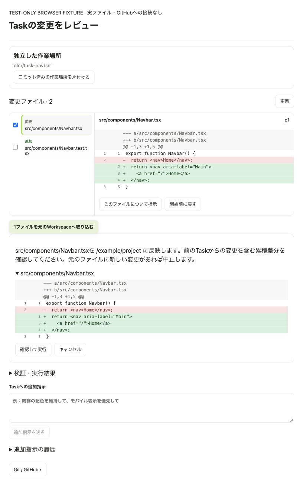

# ローカルCoding TaskのレビューとGitHub連携

実装日: 2026-10-12。Coding Orchestratorの既存の計画・段階実行・検証・停止・再開を使い、変更レビュー、追加指示、GitHub PR、独立したworktree、ローカル並行実行を追加した。

## 使用手順

要件の具体性に応じて計画の深さを変える。操作・対象範囲・技術・確認条件が実装規模に対して十分な依頼は、短い内部の実行計画へ変換してそのまま実装する。大きい実装でも、定義済みなら既定の工程ごとの続行待ちは挟まない。ユーザーが指定した承認待ちや工程での停止は優先する。

新規アプリなどで主要機能や対象範囲が不足する場合は、同じTaskのチャットで不足分だけを確認し、回答を保存して再開する。「詳細は任せる」の指定があれば、未指定部分を判断して進める。画面とロジックの分離、テストコードの作成といった成果物の境界は工程圧縮でも維持し、タスクグラフは工程の依存関係に合わせて生成する。

1. プロジェクトを選び、チャット入力付近の「新しいTaskの作業場所」を選ぶ。
   - 「現在のWorkspace」は従来の実行場所を使う。
   - 「チャットごとに独立したworktree」は、新しいチャットの最初のTaskでHEADから専用ブランチと作業場所を作る。元のWorkspaceの未コミット変更は含めない。同じチャットで完了後に追加の修正を依頼すると、前の作業場所を引き継ぎ、前の実装を維持する。各Taskはその開始時点を基準に差分を記録する。
   - この選択はTask作成時に固定され、進行中のTaskには影響しない。以前からあるTaskは従来のWorkspaceで再開する。
2. コーディングを依頼する。「まず計画を作成し、承認後に進めて」の場合は、計画を保存して承認待ちで停止する。「計画を出して」で同じTaskの計画を表示し、「この計画で進めて」「承認します」で実装を開始できる。計画の修正も通常の入力欄へ送る。修正後は改訂番号を増やして再承認を待つ。
3. Taskカードは短い状態表示と計画を中心にする。「計画と実行の詳細」で工程・検証状態・タスクグラフを開ける。「変更と実行結果」の「変更ファイル」で、ファイル別の差分、作成・変更・削除、フェーズとの対応を確認する。「検証・実行結果」には保存済みのコマンド結果を表示する。
4. 追加指示も通常のチャット入力欄を使う。実行中の既定は「完了後に進める」で、現在のTaskが完了するまで永続化して待機する。複数の待機指示は順番を保って一つの後続Taskに渡し、前の作業場所を引き継ぐ。「今の作業へ反映」は安全な工程境界で再計画する。差分の「このファイルについて指示」は入力欄へファイル名を挿入する。「通常のチャット」も選択できる。追加の権限承認が必要なTaskは、その承認を先に行う。
5. 停止後または完了後、ファイルを開始前の内容に戻せる。Task後の手編集が見つかったファイルは自動復元できない。操作時にも表示した差分revisionを照合する。
6. worktreeでは取り込み対象のファイルを選び、元のWorkspaceへ反映できる。同じチャットの前のTaskから引き継いだ変更には「前の作業」を表示し、取り込み確認で累積差分を表示する。以前の取り込みに続けて反映でき、元のファイルに別の変更がある場合は競合として中止する。全対象の確認後に書き込み、書き込みに失敗した場合は反映済みのファイルを復元する。取り込みはcommitやmergeを実行しない。
7. Task内のGit / GitHubパネルは、そのTaskの作業場所を対象にする。commit、push、ブランチ作成・切替、PR作成は内容の確認後に承認して実行する。
8. プロジェクトのTask一覧から別チャットのTaskを開ける。別の作業場所と異なるプロジェクトは同時に実行でき、同じWorkspaceは直列で処理する。

## GitHub

Gitは既存のSSH・認証設定を使う。PRの作成・一覧・詳細取得にはGitHub CLI (`gh`) と、そのMacでのGitHub認証が必要。

PR作成では、タイトル・説明・base/head・Draft・差分を承認対象にする。現在のブランチをcommit/pushしてから作成する。承認後にも送信先、公開済みHEAD、baseのHEADを照合する。同じhead/baseのopen PRが既にある場合はそのURLを返す。

PR一覧・詳細は明示的に取得し、差分、コメント、レビュー、チェック結果を表示する。これらの操作はExternal AccessがONのときだけ実行できる。PR作成はクラウドでのCoding Task実行を伴わない。

チャット/CLIの既存Gitコマンドに以下を追加した。

```text
/git branch olcr/my-feature
/git switch existing-branch
/git prs
/git pr 123
/git pr {"title":"Fix navigation","body":"Changes and validation","base":"main","draft":true}
```

作成操作は準備だけ行う。Gitパネルまたは既存の `/git approve <operation ID>` で内容を承認する。

## 保存・実行の仕様

- 作業場所、開始前のスナップショット、実行後のファイル指紋、追加指示をSQLiteに保存する。
- worktreeはDBと同じサポートディレクトリの `coding-worktrees/` に作り、`olcr/task-*` ブランチを使う。
- ファイル内容のスナップショットは1ファイル1MB、1Task合計32MB、走査は10,000ファイルまで。大きなファイルは差分表示・自動復元・取り込みの対象外とする。上限超過がCoding Taskの実装自体を止めることはない。
- `.env`、鍵、認証情報など、既知の認証ファイルの内容をスナップショット・Task差分へ保存しない。
- `.git`、依存パッケージ、ビルド出力などの走査を省略する。計画で明示されたファイルはscaffold作成前に個別に記録する。シンボリックリンクをたどる復元・取り込みには対応しない。
- 旧Taskなど基準が記録されていない場合は未記録と表示する。履歴を推測して差分を生成しない。
- worktreeを片付ける操作は、Taskが停止し、未コミット変更がない場合のみ実行できる。ブランチとcommitを保持し、同じTaskからworktreeを復元できる。同じチャットで引き継いだTaskの作業場所表示も、一緒に更新する。プロジェクトのWorkspaceとして使われている場所は削除しない。
- 同時実行数は `OLCR_CODING_CONCURRENCY` で1〜4を指定する。既定値は2。同じWorkspaceのTaskはこの数にかかわらず直列になる。
- クラウド実行、クラウドworktree、リモートTaskの委譲は後続の実装範囲。

## API

コーディング中のモデル待機にはOLCR側の時間上限を設けない。計画、実装、修復、最終報告に同じ方針を使う。一時停止要求は実行中の工程の保存境界で反映し、実際に止まるまで実行中と表示する。提供元や接続自体のエラーは失敗として記録する。

管理対象の構造化コーディングでは、MLXの推論が出力枠全体を使い切らないように、回答JSON用の枠を確保する。Ollamaで可視回答のない推論が続く場合は `reasoning_budget` として既存の復旧処理に渡す。総待機時間の上限とは別の制御で、通常チャットの推論設定には適用しない。共有のモデル実行枠を待つ間も、一時停止要求で中断できる。

Taskカードには読み込み・入力処理・生成量・モデル切替理由・実行枠待ち・最終更新からの経過時間を表示する。生成中のトークン数は完了率ではない。詳細は [2026-11-01の原因調査と検証](coding-stall-repair-2026-11-01.md) を参照。

停止時は、保存済みの工程評価と実行証拠から、停止理由・完了工程・残作業・変更ファイル・検証結果をチャットへ保存する。単なるファイル作成や未検証の結果をアプリ全体の完成として扱わない。同じ停止結果をポーリング等で繰り返し記録しない。

| API | 用途 |
|---|---|
| `GET/PUT /api/projects/{project_id}/coding-workspace` | 新規Taskの作業場所設定 |
| `GET /api/projects/{project_id}/coding-work` | プロジェクトのTask一覧 |
| `GET /api/conversations/{conversation_id}/coding-work` | チャットのTask一覧 |
| `GET /api/coding-tasks/{task_id}/review` | 差分・追加指示・保存済み実行結果 |
| `GET /api/coding-tasks/{task_id}/changes` | ファイル別の差分とreview revision |
| `POST /api/coding-tasks/{task_id}/changes/revert` | `{path, revision}` でファイル復元 |
| `POST /api/coding-tasks/{task_id}/changes/apply` | `{paths, revision}` で元のWorkspaceへ取り込み |
| `POST /api/coding-tasks/{task_id}/steer` | `{message, plan_revision}` で追加指示 |
| `POST /api/coding-tasks/{task_id}/plan/approve` | 表示中のplan revisionの承認 |
| `POST /api/coding-tasks/{task_id}/worktree/remove` | cleanなworktreeを片付ける |
| `POST /api/coding-tasks/{task_id}/worktree/restore` | 保持したブランチから作業場所を復元 |
| `GET /api/conversations/{conversation_id}/git/pull-requests` | GitHub PR一覧 |
| `GET /api/conversations/{conversation_id}/git/pull-requests/{number}` | 差分・コメント・チェック結果 |

Gitの読み取りAPIは `task_id` クエリ、準備APIは `task_id` フィールドで対象Taskを指定できる。既存の `/git/prepare` のactionに `branch`、`switch_branch`、`pull_request` を追加した。Taskとチャットの対応を検証し、別チャットのTaskを指定した操作は拒否する。

## 検証

- `backend/tests/test_task_review.py`: 開始前の手編集、staleなレビュー、手編集後の復元拒否、削除/バイナリ/実行権限、取り込みの競合とrollback、worktree再利用・復元、指示履歴、選択TaskのGit操作、PR bodyの保存形式。
- `backend/tests/test_local_coding_workflow.py`: 実行先解決、旧Taskの再開、追加指示の反映、独立Taskの並行実行、共有Workspaceの直列実行。生成モデルを固定応答に置き換えたケースでは、実際のtyped executorによるファイル編集とPython unittest実行から完了・差分保存までを確認する。
- `frontend/src/CodingTaskReview.test.tsx`: 差分と指示送信、レビューrevisionの固定、取り込み確認、手編集の保護、Task切り替え、設定保存とTask一覧。
- `frontend/browser-fixtures/coding-review/`: 実ファイルやGitHubに接続せずレビュー画面を確認するブラウザー用fixture。

実際のGitHubへのPR作成と、Tauri/macOS実機のGUI通し確認は、この変更の検証では実施していない。

最終確認: 関連バックエンド99件、フロントエンド232件が成功。TypeScriptチェックを含むproduction buildとPython構文チェックも成功。既存Coding Task回帰確認は115件成功・3件skip。production buildには既存メインbundleのサイズ警告が残る。



## 空のプロジェクトとworktree

Git未初期化・初回commit未作成・リポジトリルート以外の選択は、モデルを呼ぶ前に確認待ちへ移す。生のGitエラーで再開を繰り返さない。

- 「このTaskは現在のWorkspaceで進める」またはチャットの「現在のWorkspaceで進めて」: 同じTaskの設定だけを直接実行へ切り替える。Git初期化やcommitは作らない。
- 空フォルダのGit初期化は、UIまたはチャットで空の初回commitを作ることを明示して選択した場合のみ実行する。既存ファイルをstage/commitしない。空ではないフォルダや既存のindexは拒否する。
- 外部で準備した後は「準備した作業場所を再確認」で同じTaskを続ける。

計画・実行結果は保存済みTaskに紐づける。計画承認やTaskへの追加指示を通常モデルのコード全文回答へ落とさない。完了後の待機指示は再起動時にも回収する。

## 2026-10-12 チャット中心の操作への修正・確認

- 原因: 空の非Gitフォルダでworktree準備が失敗し、保存済み計画がないTaskの「計画を出して」「承認します」が通常チャットへ流れていた。
- 修正: モデル呼び出し前の作業場所確認、同じTaskへの自然言語操作、計画修正後の再承認、通常入力欄からの待機依頼・即時反映、後続Taskへの同一作業場所継承、コンパクトな計画カード。
- backend: `test_chat_first_coding` と `test_task_review` の51件成功。空プロジェクトの計画承認から実ファイル作成・実際の `node --test`・完了保存まで確認。生成モデルは固定応答に置換し、ホストの実行・検証・DB・ファイル操作は実物を使用した。
- frontend: 変更に関係する3ファイルの46件成功。全体は237件中233件成功、今回変更していない `HandsFreePanel.test.tsx` の4件が旧表示文言の参照で失敗。TypeScript/production build・Python構文チェック成功。メインbundleのサイズ警告は残る。
- 起動済みのネイティブアプリとユーザーの途中Taskは変更していない。今回のソースでの実GUI／実LLM通し動作は別途起動して確認する必要がある。

### 自動復旧が改善しなかった場合

`WAITING_FOR_USER / REPLAN_INEFFECTIVE` は成果物の確認や権限承認ではなく、再試行方法の選択待ちとして表示する。カードを開いた状態で停止理由、未達条件、保存されている直近の失敗を表示する。「失敗情報を使ってこの工程を再実行」ボタン、またはチャットの「再試行」「再開」で、保存済みの失敗情報を使って同じTaskの現在工程を直接再実行する。同じ計画の再生成を繰り返さず、現在の計画改訂と工程IDに結び付けた一度だけの実行許可を記録する。許可は実行時に消費し、タスク全体の復旧呼び出し上限を維持する。元の要件、承認済み範囲、完了済み工程を維持し、失敗工程を合格にしない。復旧回数の上限と実際のスコープ承認は維持する。条件変更は通常のチャットへ入力する。停止時には保存済みの成果・検証結果と操作案内をチャットにも記録する。
